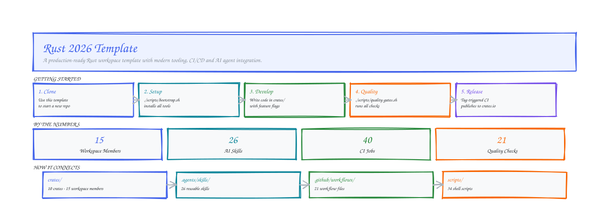

# Rust 2026 Template

[](https://github.com/d-oit/rust-2026-template/actions/workflows/ci.yml)
[](https://codecov.io/gh/d-oit/rust-2026-template)
[](LICENSE)
[](https://www.rust-lang.org)
[](.template/CHANGELOG-TEMPLATE.md#0.4.2)

**Latest release: v0.4.2** — see [`.template/CHANGELOG-TEMPLATE.md`](.template/CHANGELOG-TEMPLATE.md) for the full changelog.

A production-ready Rust workspace template with modern tooling, CI/CD and AI agent integration.

## Overview



This template is designed for Rust developers who want to start new projects with best practices baked in. It provides a modular workspace structure, comprehensive quality gates, and built-in support for AI-assisted development.

## Features

- **Rust 2024 Edition:** Leverages the latest language features and idioms with an MSRV of 1.88.
- **Workspace Layout:** Clean separation of concerns with a `crates/` directory for internal libraries and applications.
- **Security First:** Pre-configured supply chain audits, secret scanning, and hardened configuration patterns.
- **Performance Optimized:** Optimized dev profiles with reduced debug artifacts and disk space savings.
- **AI-Native:** First-class support for AI coding agents with specialized skills and canonical instruction sets. Includes `llms.txt` for machine-readable project context.

## Example

`sample-app` is the runnable reference. The workspace itself is virtual — there is
no root `[package]`, so member crates are the entry points:

```bash
cargo run -p sample-app
```

## Documentation Map

This repository uses a layered documentation strategy to serve both human developers and AI agents:

| Layer | File / Directory | Audience | Purpose |
|-------|------------------|----------|---------|
| **Human Onboarding** | `README.md`, `QUICKSTART.md` | Humans | High-level project overview and setup |
| **Agent Contract** | `AGENTS.md` | AI Agents | Canonical rules and project contract (SSOT) |
| **Reusable Procedures** | `.agents/skills/` | AI Agents | Step-by-step executable task knowledge |
| **Tool Adapters** | `CLAUDE.md`, `QWEN.md`, etc. | Specific Tools | Tool-specific deltas and harness quirks |

### AI Editor Integration

| Editor / Agent | Config Location | Included |
|---|---|---|
| Claude Code | `.claude/` | ✅ |
| Qwen | `.qwen/` | ✅ |
| OpenCode | `.opencode/` | ✅ |

## Included Tooling

- **Testing:** `cargo-nextest` for faster test execution and `proptest` for property-based testing.
- **Quality Assurance:** `cargo-mutants` for mutation testing and `clippy` with a zero-warnings policy. The template includes a pre-configured workspace-level lint suite that prevents common pitfalls like `unwrap()` in library code.
- **CI/CD:** Multi-stage GitHub Actions for linting, testing, security audits, and automated releases.
- **crates.io Trusted Publishing:** Opt-in, OIDC-based crate releases with no long-lived registry token. See [the full lifecycle guide](docs/src/releasing/crates-io-trusted-publishing.md).
- **Local Workflows:** Helper scripts for running the entire quality gate pipeline locally.

## Quick Start

1. **Use this Template:** Click the **"Use this template"** button on GitHub.
2. **Setup:** Follow the detailed instructions in **[QUICKSTART.md](QUICKSTART.md)**.
3. **Customize:** Rename the placeholder crates and update `Cargo.toml` metadata.
4. **Develop:** Use `./scripts/quality-gates.sh` to ensure your changes meet the project's quality standards.

## Repository Structure

```text
.
├── .agents/             # AI agent specialized skills and workflow definitions
│   ├── context/         # Cross-repo context for derived repositories
│   └── skills/          # Executable task knowledge and canonical workflows
├── .cargo/              # Cargo configuration (linker, profiles, aliases)
├── .github/             # GitHub Actions workflows and issue templates
├── agents-docs/         # Detailed documentation for AI agents
├── benchmarks/          # Criterion benchmark suites
├── config/              # Template profiles, xtask tiers, and publishing config
│   ├── profiles/        # Environment-specific runtime JSON configs (default.json, etc.)
│   └── template-profiles/  # Validated blueprints for `init-template.sh`
├── crates/              # Workspace member crates
│   ├── actor-runtime-template/
│   ├── checkpoint-template/
│   ├── example-crate/   # Placeholder library crate
│   ├── example-registry-pattern/
│   ├── example-storage-pattern/
│   ├── hybrid-storage-template/
│   ├── mcp-server-template/
│   ├── sample-app/      # Reference application implementing best practices
│   ├── workspace-tests/ # Workspace-level integration and architecture fitness tests
│   └── xtask/           # Cargo task runner
├── docs/                # mdbook documentation and architecture guides
├── examples/            # Standalone example binaries
│   ├── cli_dry_run/     # Non-destructive CLI invocation example
│   ├── hello_world/     # Simple hello world example
│   ├── security_egress_and_path_validation/
│   └── security_secret_detector/
├── fuzz/                # cargo-fuzz testing scaffold
├── hooks/               # Git hooks (session-start.sh, etc.)
├── reports/             # Tracked DORA/quality reports (see Output Artifacts)
├── schema/              # JSON Schema definitions for config/API contracts
├── scripts/             # Automation scripts for quality gates and releases
├── AGENTS.md            # Canonical instructions for AI coding agents
├── llms.txt             # LLM context file (machine-readable project overview)
├── Cargo.toml           # Workspace manifest
└── QUICKSTART.md        # Comprehensive setup guide
```

## CI/CD and Quality Gates

The project enforces high standards through a multi-layered verification process:

- **CI Pipeline:** Automatically runs formatting checks, Clippy lints, tests, security audits (`cargo-audit`), supply chain checks (`cargo-deny`), benchmarks compile-check, and VERSION consistency checks on every PR.
- **Local Gates:** Run `./scripts/quality-gates.sh` before committing to mirror the CI checks locally.
- **Mutation Testing:** Periodic runs of `cargo-mutants` verify that your tests actually catch bugs.

## GitHub Hardening

This template includes guidance for securing harness files, hooks, workflow definitions, and related governance files on GitHub. The guidance covers optional protections for sensitive paths, CODEOWNERS patterns, branch configuration, and security features.

See [docs/github-hardening.md](docs/github-hardening.md) for the full guide.

## Feature Flags

The workspace has no root package, so all feature flags live on member crates:

| Crate | Feature | Description |
|-------|---------|-------------|
| `example-storage-pattern` | `mock` | **Preferred** trait-only storage pattern |
| `hybrid-storage-template` | (none / `MemoryBackend`) | Working in-memory hybrid wrapper |
| `hybrid-storage-template` | `sqlite` | Fail-closed SQLite **stub** (not production) |

Pattern selection: [docs/patterns/README.md](docs/patterns/README.md).

## Project Profiles

Choose a validated blueprint from `config/template-profiles/` that shapes the generated
workspace: which crates stay, which workflows run, the default CI tier, and lockfile policy.

| Profile | Best for | Keeps | Lockfile Policy |
|---|---|---|---|
| `minimal` | Small app | `sample-app` + renamed lib crate + `xtask`; drops pattern crates, benchmarks, fuzz, heavy workflows | Committed (`Cargo.lock` tracked) |
| `library` | Reusable library | renamed lib crate + `xtask` + workspace tests | Ignored (library standard) |
| `service` | Long-running service | actor/storage/registry patterns + `xtask` | Committed (`Cargo.lock` tracked) |
| `workspace` | Full reference | every crate, benchmark, and workflow | Committed (`Cargo.lock` tracked) |
| `ai-agent` | Agent-centric dev | `sample-app` + lib crate + `xtask` + agent tooling | Committed (`Cargo.lock` tracked) |
| `performance-sensitive` | Performance-critical | benchmark harness + lib crate + `xtask` + reference runner checklist | Committed (`Cargo.lock` tracked) |

`sample-app` is the binary/CLI starter. The legacy `--profile cli` spelling
aliases `minimal`'s workspace while retaining its historical
`protected-branch` CI tier, committed lockfile, and optional CLI manpage
checklist item. `minimal` and `library` retain core Rust build, test, lint,
release, privacy/security, and basic PR-review skills; other profiles select
additional agent-development capabilities as appropriate. In the
agent-centric profile, skill authoring/evaluation is included; the `workspace`
profile retains the full maintainer and metrics skill set.

```bash
./scripts/init-template.sh --profile library --name my-lib
# equivalent xtask commands
cargo run -p xtask --bin xtask -- template init --profile minimal --name my-app
cargo run -p xtask --bin xtask -- template validate-profile --profile config/template-profiles/library.toml
cargo run -p xtask --bin xtask -- template inspect --profile service
```

`--minimal` remains a shorthand for `--profile minimal`. Full detail:
[docs/template-profiles.md](docs/template-profiles.md).

## Benchmarks

The template provides a dedicated `benchmarks/` workspace crate with Criterion benchmark suites (`end_to_end`, `memory_usage`).

See **[QUICKSTART.md](QUICKSTART.md)** for detailed benchmark and performance testing instructions.

## Fuzz Testing

A fuzz testing scaffold is included using `cargo-fuzz`. The fuzzer runs weekly via GitHub Actions.

See the **Advanced Testing** section in **[QUICKSTART.md](QUICKSTART.md)** for local usage instructions.

## AI Assistant Context Files

This template ships structured context files for AI coding assistants. These files help agents understand the project structure and rules quickly.

- **`llms.txt`**: Condensed project overview for token-efficient LLM context.
- **`llms-full.txt`**: Complete source context for deep analysis (auto-generated).

See **[AGENTS.md](AGENTS.md)** for instructions on maintaining and using these context files.

## Output Artifacts

The project uses several directories for generated artifacts and documentation:

- **`reports/`**: Generated DORA and quality reports. `reports/DORA-REPORT.md`, `reports/dora-history.jsonl`, `reports/dora-manifest.json`, and `reports/quality-report.json` are tracked so their history is reviewable; the ignore rules for scratch HTML output live under the `# Coverage reports` block in `.gitignore`.
- **`.agents/ci/`**: CI telemetry and generated summaries. `ci-status.json` and `ci-summary.md` are tracked (CI no longer writes them back; they are regenerated locally by `./scripts/quality-gates.sh`), while volatile artifacts such as `quality-run.json` are git-ignored and uploaded as workflow artifacts.
- **`target/`**: Rust build artifacts.

## VERSION File

A `VERSION` file at the repo root is a plain-text source of truth for tooling that can't easily parse TOML.

> **Versioning note:** `VERSION` and `Cargo.toml [workspace.package].version` are the *starter* version inherited by generated projects (`0.0.0` in the template). The template's own meta-release version lives only in `.template/CHANGELOG-TEMPLATE.md` — see #135.

```bash
VERSION=$(cat VERSION)
echo "Building version $VERSION"
```

The `VERSION consistency check` CI job runs `scripts/propagate-version.sh --check`, which fails when `VERSION`, the workspace version, or any member's inherited version disagrees. The same job also runs `scripts/check-template-version.sh` (README badge vs newest changelog release) and regenerates `llms.txt` and `.agents/SKILLS.md` to assert they are current.

## Cargo.lock Policy

The template repository itself does **not** commit `Cargo.lock` by default because it acts as a template for library and application crates alike. Downstream lockfile handling is determined by template initialization profiles:

- **Binary Application Profiles** (`cli` compatibility alias, `service`, `ai-agent`, `minimal`, `workspace`): `cargo xtask template init` automatically un-ignores and tracks `Cargo.lock` in `.gitignore` so generated binary projects commit `Cargo.lock` for reproducible builds by default.
- **Library Profile** (`library`): Keeps `Cargo.lock` ignored in `.gitignore`, adhering to Cargo recommendations for library crates so downstream consumers resolve exact dependency versions via `cargo update`.

See the [Cargo docs on Cargo.lock](https://doc.rust-lang.org/cargo/guide/cargo-toml-vs-cargo-lock.html) for full rationale.

## Customization Guidance

To adapt this template to your needs:

- **Renaming Crates:** Search and replace `example-crate` and `sample-app` with your desired crate names.
- **Adjusting Lints:** The lint policy lives in `[workspace.lints]` in the root `Cargo.toml` (a virtual workspace has no root package to attach attributes to). `.clippy.toml` holds Clippy's behavioural thresholds such as `cognitive-complexity-threshold`, not the lint levels.
- **Security Policy:** Review `deny.toml` to customize allowed licenses and dependency bans.

## Maintenance

Contributions are welcome! Please refer to **[CONTRIBUTING.md](CONTRIBUTING.md)** for guidelines on how to propose changes or report issues. Security vulnerabilities should be reported according to the process in **[SECURITY.md](SECURITY.md)**.

## License

This project is licensed under the MIT License - see the [LICENSE](LICENSE) file for details.
